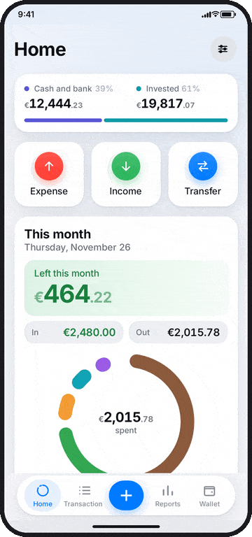

# Cents

A personal finance app for Android that keeps everything on the phone. It records what you spend
and earn, mostly without typing: when you pay with your phone or card, it reads the bank's
notification and writes the movement down for you.

<table>
  <tr>
    <td align="center" width="33%"></td>
    <td align="center" width="33%"></td>
    <td align="center" width="33%"></td>
  </tr>
  <tr>
    <td align="center"><b>Payments record themselves</b><br><sub>From the bank's notification. One tap files it.</sub></td>
    <td align="center"><b>What you have, over time</b><br><sub>Net worth, and each investment's history.</sub></td>
    <td align="center"><b>Where the money went</b><br><sub>Budgets, categories, month by month.</sub></td>
  </tr>
</table>

## How it works

1. **You pay.** The bank app shows its usual notification.
2. **Cents reads it** — only from the apps you choose — and records the amount in the right
   account. It never connects to the bank or asks for its password.
3. **You file it** with one tap on a category, whenever you like. Until then it still counts in
   every total.

Rent, salaries and subscriptions record themselves on their day. Anything else takes a few taps on
a keypad.

## What it does

- **Home**: what is left this month, and what is waiting for a category.
- **Accounts** with transfers between them. Balances are computed from the movements.
- **Reports**: spending by category, income against expenses, the balance over time, budgets.
  Every chart opens the movements behind it.
- **Investments**: broker accounts holding stocks, ETFs, funds and crypto. It shows what you put
  in, what it is worth now, the profit, and how the value moved by week, month or year.
- **Your data**: JSON or CSV export, and an optional daily backup to your own Google Drive.
- English and Spanish.

Everything stays on the device: no account, no server, no analytics.

## Building

```bash
./gradlew assembleDebug        # build
./gradlew installDebug         # install on a connected phone
./gradlew testDebugUnitTest    # tests, all on the JVM
./gradlew detekt spotlessCheck # static analysis and formatting
```

Kotlin and Jetpack Compose, MVVM, Room, Hilt, Vico for charts. Setting up a machine from zero is in
[`docs/setup.md`](docs/setup.md). The GIFs above are recorded from the app itself, with invented
data, by [`docs/media/make_gifs.py`](docs/media/make_gifs.py).

## More

- [`docs/PRD.md`](docs/PRD.md): what the product is, and its roadmap.
- [`PLAN.md`](PLAN.md): where it stands and what comes next.
- [`CLAUDE.md`](CLAUDE.md): the rules the code follows, and why money is a `Long` of cents.

## License

Not decided; the repository is private. The bundled Inter typeface is under the SIL Open Font
License, in [`docs/licenses/`](docs/licenses/).
