# 0003 — The ring: the look the UI moves to when it is reworked

- **Status:** proposed. The owner chose this look on 2026-09-26, from the film of the app, and
  will adopt it when the UI rework starts. Until then nothing here binds a screen: ADRs 0001 and
  0002 still do, and rule 12 in `CLAUDE.md` still points at them.
- **Date:** 2026-09-26
- **Applies to:** everything under `ui/`, from the day this record is accepted
- **On acceptance:** supersedes [`0002-bubble-launcher.md`](0002-bubble-launcher.md), because
  the app opens on the month instead of on the bubbles, which is the replacement `PLAN.md` C7 has
  been waiting for. It also amends [`0001-ios-flavored-ui.md`](0001-ios-flavored-ui.md) where the
  table below says so, and `CLAUDE.md` rule 12 then points here as well.
- **Source:** the film of the app, `showreel/` on the branch
  `claude/libreyolo-motion-showreel-e0emos`. Its `ui.js` is the kit these screens were drawn
  with, in HTML, and the pictures below are stills from it. The figures in them are samples.

## Decision

When the UI is reworked, Cents takes the look of its film: **one idea, a ring of category
colours that says where the money went, and otherwise white cards on a pale canvas, one clear
number each, and room around everything.**

It is still the app ADR 0001 describes: the iOS system palette, Inter, cards on a grouped
background, the iOS switch, segmented control and sheet, push and pop, and a fixed palette with
no dynamic colour. What changes is the temperature. There are fewer lines, bigger numbers and
softer surfaces, and motion shows what just happened.

The app opens on **the month**: the ring, the total in its centre, and the categories under it,
largest first.

## The screens

| | | |
|:-:|:-:|:-:|
| 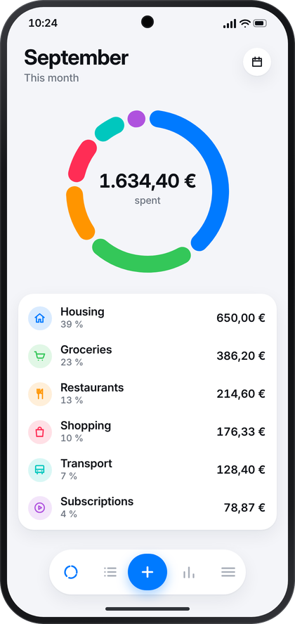 **The month.** Where it went. | 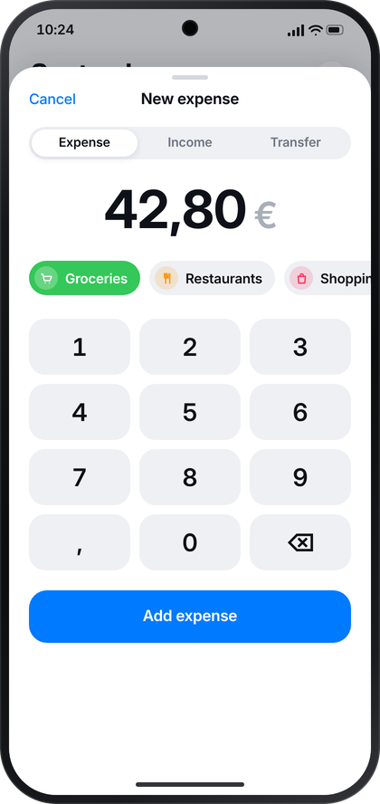 **A new movement.** Amount, category, done. | 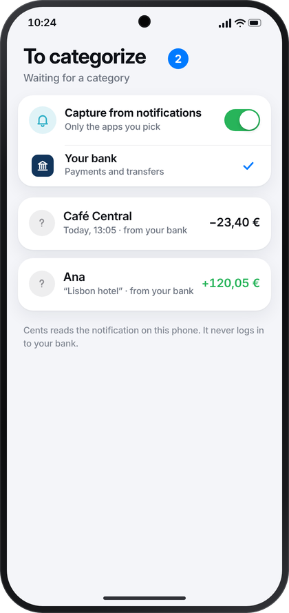 **Capture** (planned, PRD §4.6). |
| 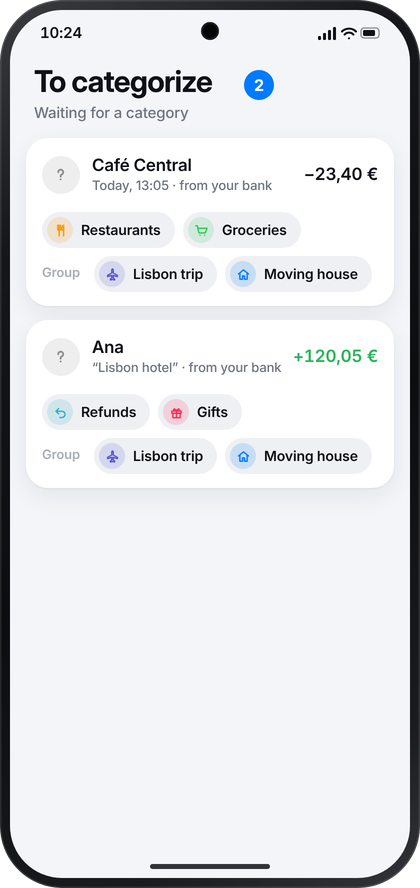 **To categorize.** A category, and a group. | 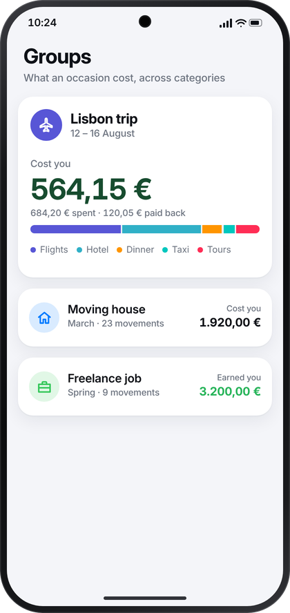 **Groups.** Cost you, or earned you. | 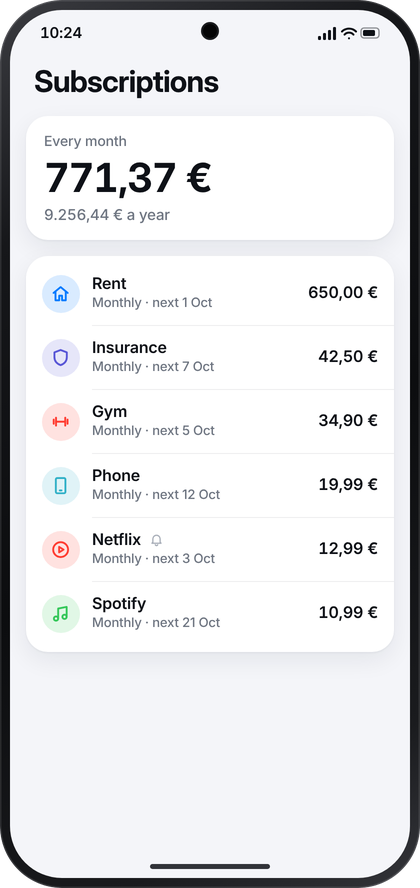 **Subscriptions.** A month and a year. |
| 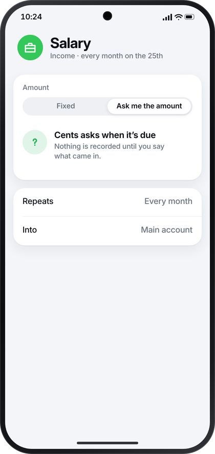 **Ask me the amount.** | 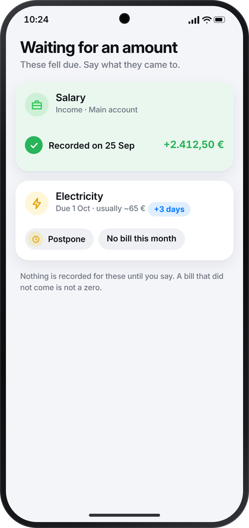 **Waiting for an amount.** | 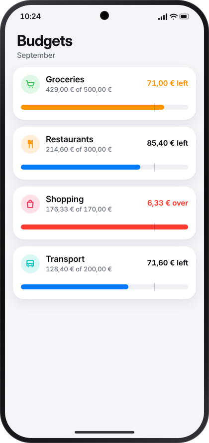 **Budgets.** Amber at 80 %, red over. |
| 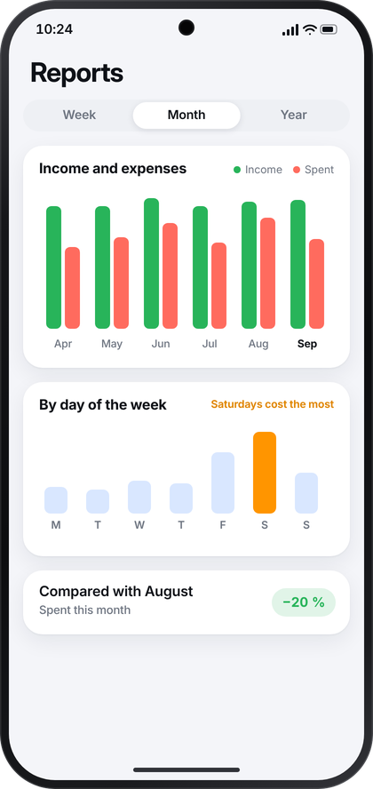 **Reports.** | 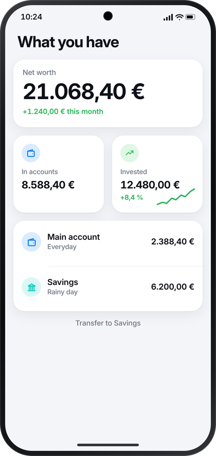 **What you have.** | 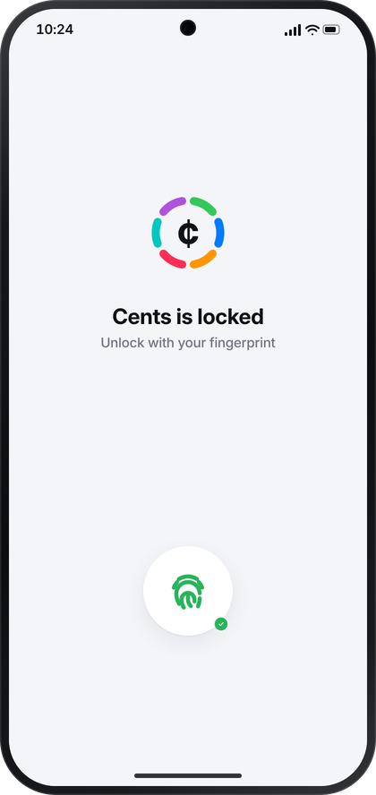 **Locked.** Behind the system prompt. |
| 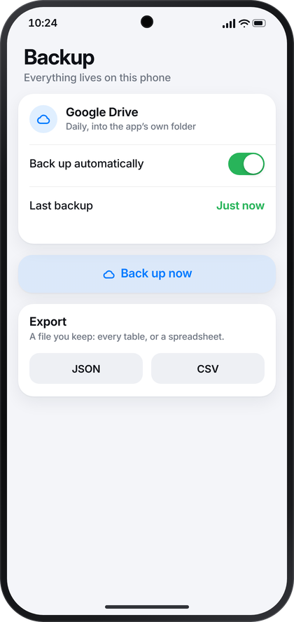 **Backup and export.** | | |

## Four rules for everything the pictures do not show

1. **One screen, one question.** The month answers *where did it go*, budgets *how close am I*.
   A screen that answers two questions is two screens.
2. **The number is the headline.** A card leads with one figure in the display style. Everything
   else on it is smaller and grey.
3. **Colour means something.** A colour on screen is a category's, or a state: green is money in,
   amber is near a limit, red is over. The accent blue is for what can be tapped. Everything else
   is grey.
4. **Motion explains a change.** Something moves only because something happened: a movement
   saved, a card filed, a number changed. Nothing loops and nothing drifts. With the system's
   animations off, every change is instant.

## What changes against ADR 0001, and what stays

| Aspect | ADR 0001 and 0002, as built | With this record |
|---|---|---|
| Home | A canvas of bubbles in front of the tab bar (0002) | **The month**: the ring and the categories. The canvas and its stored layout go |
| Tabs | Bottom tab bar, icon over label | A **floating capsule** with icons and an add button in the middle. The names move into content descriptions, and TalkBack still hears *tab, 2 of 4* |
| Lists | Inset grouped lists, 10 dp corners, section headers | **Cards**: 22 dp corners, a soft shadow in light, 16 dp apart, one subject per card, and a heading inside the card rather than above it |
| Controls | Plain-text tinted buttons; no chips, no filled buttons | **Chips** for one-tap choices (a category, a group). **One filled primary button** per sheet (*Add expense*). Everything else stays plain text or sits on a grey fill |
| Colour | iOS system palette; black text on `#F2F2F7` | The same accent and category palette; ink `#0E1117` and cool greys on `#F4F5F9`; text-safe variants of the signal colours (below) |
| Type | Inter on the iOS text scale | The same, plus a **display** style for the one number a card leads with; the large title drops from 34 to 30, and running text moves from Regular to Medium |
| Motion | Push and pop, springs | Navigation unchanged. Adds content arriving in sequence, numbers that count to their new value, and the ring drawing itself and re-balancing |

**What stays exactly as it is:** the back gesture and push/pop, alerts and action sheets, the swipe
that deletes or springs back, the switch, sheets with a grabber, light haptics on selection and
confirmation, Inter, the in-house stroke icons, the fixed palette, and every system surface that
ADR 0001 keeps native: notifications, share, permission and biometric prompts.

## Tokens

These map onto the existing `CentsColors`, `CentsDimens` and `CentsTypography`. A new token is
named for its role, never for its value, as today.

### Colour, light

| Token | Value | Today | Used for |
|---|---|---|---|
| `groupedBackground` (canvas) | `#F4F5F9` | `#F2F2F7` | Behind everything |
| `groupedCard` | `#FFFFFF` | same | Cards, the tab capsule, the toast's text |
| `label` (ink) | `#0E1117` | `#000000` | Titles, numbers, row names |
| `secondaryLabel` | `#6B717D` | `#3C3C43` at 60 % | Subtitles, captions, row details |
| `tertiaryLabel` | `#A9AFB9` | `#3C3C43` at 30 % | Placeholders and disabled text only, never content (2.2:1) |
| `inactiveIcon` *(new)* | `#898E96` | none | Unselected tab icons (3:1) |
| `fill` *(new)* | `#EEF0F4` | none | Chips, keypad keys, the segmented track, input fields |
| `separator` | `#0E1117` at 7 % | `#3C3C43` at 29 % | Hairlines inside a card, inset to the text |
| `accent` | `#007AFF` | same | Filled buttons, the add button, the selected tab, links |
| `positive` | `#28B45A` | `#34C759` | Fills for money in and for *on*: income bars, the switch, a recorded tick. A shade deeper than the category green `#34C759`, so money in never reads as Groceries |
| `warning` | `#FF9500` | same | Fills: a budget past 80 %, the week's most expensive day |
| `destructive` | `#FF3B30` | same | Fills: a budget over, destructive actions |
| `cardShadow` *(new)* | Two layers of `rgba(16, 24, 40, …)`: 5 % at y 1, blur 2; 7 % at y 8, blur 24 | none | Under cards and the tab capsule, light only |

**Text-safe variants.** The iOS signal colours are made for fills. As text on white or on the
canvas they fall short of 4.5:1, and the app had its accessibility pass in #96. So text in a signal
colour uses a darker twin. Each twin reaches at least 4.5:1 on the canvas and about 5:1 on white:

| Text in | Twin | On white | On canvas |
|---|---|---|---|
| Green, money in (`+120,05 €`) | `#1C8040` | 4.99 | 4.58 |
| Amber, near a limit | `#A16000` | 5.01 | 4.60 |
| Red, over a limit | `#D43128` | 4.92 | 4.51 |
| Blue, a text button (*Cancel*) | `#006BE0` | 5.02 | 4.61 |
| Secondary text | `#6B717D` | 4.90 | 4.50 |

The film draws green text at `#28B45A` and grey at `#6E7581`. Those look right on a video frame and
fail on a phone in daylight. The table wins.

### Colour, dark

The film is light only, and dark keeps ADR 0001's dark palette: the canvas is black, cards are
`#1C1C1E` and carry **no shadow**, because elevation reads from the lighter card. Ink is white,
secondary text is `#EBEBF5` at 60 %, `fill` is `#2C2C2E`, and the signal colours are Apple's dark
variants. Those already clear 4.5:1 on black, so they need no twins. A category keeps the colour
it was given, and the ring on black is the same ring.

### Type

Inter throughout, as today. Every figure that is money uses **tabular numbers**
(`fontFeatureSettings = "tnum"`), so a total that counts does not jitter.

| Role | Size / line | Weight | Tracking | Where |
|---|---|---|---|---|
| `display` *(new)* | 40 / 46 | Bold | −0.03 em | The one number a card leads with: net worth, what a group cost, every month |
| `largeTitle` | 30 / 36 | Bold | −0.025 em | Screen titles (today 34 / 41) |
| `title3` | 20 / 25 | Bold | −0.02 em | A card's own title (*Lisbon trip*) |
| `headline` | 17 / 22 | SemiBold | −0.01 em | Row names, amounts in rows |
| `callout` | 16 / 21 | Medium | −0.01 em | Settings rows, text buttons |
| `subhead` | 15 / 20 | Medium | −0.01 em | A screen's subtitle, chips at 15 |
| `footnote` | 13 / 18 | Medium | 0 | Row details (*Today, 13:05 · from your bank*) |
| `caption1` | 12 / 16 | SemiBold | +0.1 em, capitals | Small labels (*MOST SPENT THIS MONTH*) |

**Running text is Medium (500), not Regular.** At 13–15 sp, Inter's Regular reads thin beside
the bold numbers, and the film sets every line of body text at 500. This is the one change of
weight from today's scale, and `InterFamily` already carries it.

The ring's centre uses 27 / 32 Bold for the total. The keypad uses 27 SemiBold.

### Shape, spacing and elevation

| Token | Value | Today |
|---|---|---|
| `screenMargin` | 16 dp | same |
| `cardCornerRadius` | 22 dp | `groupedCornerRadius` 10 dp |
| `cardPadding` | 16–18 dp | 16 dp row padding |
| `cardSpacing` | 16 dp between cards | `sectionSpacing` 35 dp |
| Row height inside a card | 54–64 dp, icon 34–38 dp | 44 dp minimum |
| Chip | 36 dp tall visually, fully rounded, 26 dp badge, 8 dp gap; **touch target 48 dp** | none |
| Primary button | 54–58 dp, 20 dp corners | none |
| Keypad key | 62 dp tall, 18 dp corners, `fill` | `CentsKeypad` |
| Segmented control | 36 dp, fully rounded, white thumb with a soft shadow | `CentsSegmentedControl` |
| Tab capsule | 64 dp tall, fully rounded, 16 dp above the gesture area; add button 56 × 52 dp | `CentsTabBar` 49 dp |
| Sheet | 30 dp top corners, 40 × 5 dp grabber, the screen dimmed to 28 % ink | `CentsActionSheet` |

The card shadow is drawn with Compose's `Modifier.dropShadow`, available since Compose UI 1.9
and so in the 2026.02 BOM this project uses. `Modifier.shadow` is not used, because its elevation
shadow is Material's.

### Icons

- **A category's badge**: a circle in the category's colour at 15 %, and the glyph in the full
  colour. The **solid** variant, full colour with a white glyph, is for the one thing a screen
  is about: a group's own icon, a callout.
- **Glyphs** stay the in-house stroke drawings ADR 0001 describes: a 24-unit grid, a 2 dp stroke,
  round caps and joins. The film adds a few that the app will need: refund, gift, bank, bell,
  fingerprint and the ring.

## Components

What the rework builds, each on Compose Foundation and none of it a restyled Material widget:

- **`CentsRing`**. The signature. One arc per category, drawn with `drawArc` and
  `StrokeCap.Round`, clockwise from twelve o'clock, largest first, with a 6 dp gap between arcs.
  The round caps eat into each arc, so each end gives back `thickness / 2 / radius` radians. An
  arc too small for its own caps is drawn as a dot: that is the purple *Subscriptions* on the
  month. The total and a caption sit in the centre. The slices come from the same
  spending-by-category query that Reports already runs in SQL (`CLAUDE.md` §5). The ring is
  decorative to TalkBack: the list under it says the same thing in words.
- **`CategoryBadge`** and **`CategoryChip`**. A picked chip fills with the category's colour and
  its text turns white.
- **`CentsCard`**. The card, with its shadow in light and without it in dark.
- **`AmountText`**. Money that counts from the old value to the new one when it changes.
  **Money stays a `Long`** (rule 1): what animates is a `Float` from 0 to 1, and each frame shows
  `old + ((new - old) * fraction).roundToLong()`.
- **`FloatingTabBar`**. The capsule, the add button in the middle, and each tab carrying
  `Role.Tab`, its selected state and its section's name, so TalkBack keeps what the plain tab bar
  gave for free.
- **`CentsToast`**. A dark pill under the status bar: a green tick and *Added to Groceries*. It
  is a polite live region, so TalkBack reads it once.
- **`BudgetBar`**. A 10 dp track on `fill` with a hairline at 80 %. The fill is blue, then amber
  from 80 %, then red past 100 %, and the words beside it say *left* or *over*, so colour is never
  the only signal.
- **`DoneState`**. A tinted circle whose tick draws itself, a title and a line: *All sorted*.

## Motion

The film's timings, in the units Compose takes. Easings are cubic Béziers
(`CubicBezierEasing`). Springs are given as Compose's `dampingRatio` and `stiffness`, where
stiffness is `(2π × frequency)²`.

| What | How | Compose |
|---|---|---|
| A screen's cards arriving | Each rises 26 dp and fades in over 700 ms, 60–120 ms after the one before | `tween(700, delayMillis = i * 80, easing = CubicBezierEasing(0.16f, 1f, 0.3f, 1f))` |
| Leaving | Rise 14 dp and fade, 340 ms, faster than arriving | `tween(340, easing = CubicBezierEasing(0.32f, 0f, 0.67f, 0f))` |
| A total changing | Counts to the new value in 800–1200 ms | `tween(1000, easing = CubicBezierEasing(0.33f, 1f, 0.68f, 1f))` |
| The ring drawing on | Arc by arc, 500 ms each, 160 ms apart | as above, per arc |
| The ring re-balancing | Every arc to its new share at once, 800 ms | `tween(800, easing = CubicBezierEasing(0.65f, 0f, 0.35f, 1f))` |
| One slice highlighted | It moves out 7 dp and thickens 4 dp; the others fade to 38 % | 600 ms, same easing |
| A sheet rising | A spring that barely overshoots | `spring(dampingRatio = 0.86f, stiffness = 174f)` |
| A chip picked | Colour in 300 ms; the chip swells to 1.06 and back | `tween(300)` + a `spring` on scale |
| A row filed | Slides out left in 400 ms; the next one springs up into its place | `tween(400)` in; `spring(0.78f, 227f)` |
| A count badge changing | A quick overshoot | `spring(dampingRatio = 0.4f, stiffness = 570f)` from 1.18 |
| A budget filling | 1.3 s; a single 3 dp shake if it goes over | `tween(1300)`; the shake decays in 300 ms |
| Pressed | Scale 0.92–0.96 while held, back in 150–250 ms, with the light haptic ADR 0001 asks for | `animateFloatAsState` |
| A check mark | Draws itself in 400 ms | `PathMeasure` segment |

**Animations off means none of it.** When `ANIMATOR_DURATION_SCALE` is 0, every value jumps to
its end, as ADR 0002 already does for the drift.

## The month, in detail

The screen that replaces the bubbles, and the one that most needs to be right:

- The header is the period, *September*, in the large title, and *This month* under it. A round
  card button on the right opens the period picker.
- The ring sits under the header at about 58 % of the screen's width, with a stroke about a
  tenth of its diameter. The total goes in its centre with *spent* under it.
- Under the ring, one card holds every category with spending this period, **largest first**:
  badge, name, share and amount. The share is truncated the way `SpendingSection.kt` writes it,
  so a list never adds up to 101 %. A row opens the movements behind it, as a slice does in
  Reports today.
- On opening, the ring draws itself, the rows arrive one after another, and the largest category
  is picked out once: its slice moves out while the rest fade back. After a save the ring
  re-balances, the total counts up, and a toast says where the movement went.
- The floating bar sits at the bottom, and its add button opens the new-movement sheet.

## Accessibility, carried over rather than started again

- **48 dp touch targets** everywhere, a chip included, whatever its drawn size
  (`Modifier.minimumInteractiveComponentSize()`).
- **Colour is never the only signal.** Money in carries a `+` as well as green; a budget says
  *left* or *over*; the ring has the list under it.
- **Text grows with the system font.** Cards grow in height, and a display number that no longer
  fits shrinks to fit rather than being clipped.
- **TalkBack keeps roles and headings** (#96). The capsule's tabs say *tab* and their position,
  the toast is a live region, and a picked chip reads as selected.
- **Contrast** follows the text-safe table above.

## Building it, in this order

`ui/theme` is one of the shared bottlenecks `CLAUDE.md` §7 names, so the first step runs alone:

1. **Tokens.** The colours, the type roles, the shape and spacing values, and the shadow. It is
   one branch, and every screen shifts at once without changing its layout.
2. **Components.** `CentsCard`, `CategoryBadge`, `CategoryChip`, `AmountText`, `CentsRing`,
   `FloatingTabBar`, `CentsToast`, `BudgetBar` and `DoneState`, each with a preview and tests.
3. **The month and the shell.** The month becomes the start destination and the capsule replaces
   the tab bar. The bubble canvas, its stored layout and *Reset the bubble layout* are removed,
   and 0002 is marked superseded.
4. **The screens**, one branch each and parallel where their files do not overlap: the new-movement
   sheet, To categorize, Groups, Subscriptions and *Waiting for an amount*, Budgets, Reports, What
   you have, and Settings with Backup.

Capture, the screen third in the pictures, is drawn here so the feature has a look waiting for
it. It is built when the owner asks for PRD §4.6, not as part of the rework.

## Open questions, with the default that gets built

These go to `DECISIONS.md` when the rework starts. Until then they live here:

1. **Which places the capsule holds.** Today there are five sections, and the capsule has room
   for four around the add button. *Default:* Month · Movements · **+** · Reports · What you
   have, where Accounts and Investments become one place because D19 already shows what is in
   accounts, what is invested and the net worth together. Settings opens from a button in the
   Month's header.
2. **Whether the bubbles survive as an option.** *Default:* no. They go with their stored layout,
   because a launcher nobody opens is code nobody walks.
3. **The logo.** The coin in a ring of category colours was drawn for the film, and the app still
   ships the default launcher icon. *Default:* it becomes the adaptive launcher icon, the ring on
   the foreground layer and the canvas colour behind it.

## Alternatives considered

- **Keep ADR 0001's look and replace the bubbles with the plain tab bar.** This is the cheapest
  answer to C7, and it was always on the table. It is not what the owner chose once they had
  seen both.
- **Material 3 Expressive.** It is Compose's own new look, and it is rejected for the reason ADR
  0001 gives. A finance app that the owner wants to feel like an Apple app does not become one by
  adopting Google's newest style.
- **Draw the ring with a charting library.** Vico already carries a pie, and it is what Reports
  uses. The ring's gaps, round ends, dots for small slices and per-arc motion are the whole point
  of it, though, and a `Canvas` with `drawArc` is less code than bending a chart into that.
